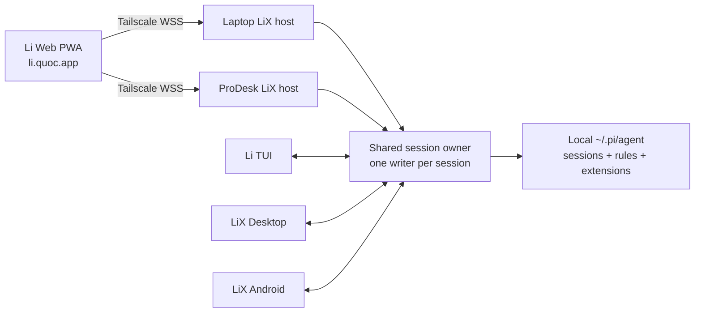
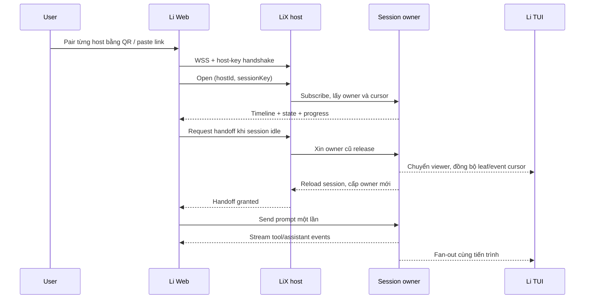

# Spec: Li Web — workbench trình duyệt cho LiX

## Context Snapshot
- Project chính: LiX tại `D:\pcloud\workspace\code\android\pi-app\pi-app`; Pi/Li runtime dùng chung nằm ở `D:\pcloud\workspace\code\pi-mono-li`.
- Stack hiện tại (SNAPSHOT, có thể stale — T0 PHẢI verify lại trên host thật trước khi làm gì khác): LiX Electron + React/TypeScript + Android Kotlin/Compose; repo Pi app pin `@earendil-works/pi-coding-agent` 1.0.2 (dist không chứa `session-open-lease` — lease/owner code chỉ có ở pi-mono-li 1.3.x); Laptop `li --version` là 1.3.0. HOMELAB snapshot ghi ProDesk LiX 0.7.12/SDK 1.0.2, Pi Android báo 0.7.13 ở safe boundary — con số này không được dùng làm bằng chứng version.
- Hiện trạng: LiX chưa có browser build. Renderer gọi Electron IPC qua `window.piDesktop`; app có Android Remote Gateway WebSocket `/ws`, QR pairing và RPC subset. Không có cross-process writer lease được chứng minh.
- Desired behavior: một `li.quoc.app` browser workbench truy cập Laptop và ProDesk qua host riêng; TUI, LiX Desktop/Android và Web cùng xem session và live progress; mỗi session chỉ có một writer, user handoff rõ ràng.
- Relevant LiX files: `src/main/remote/{gateway,connection,rpc,session-hub,auth-store}.ts`, `src/main/remote-host-electron.ts`, `src/main/worker-manager.ts`, `src/main/terminal/**`, `packages/shared/remote/**`, `src/preload/index.ts`, `src/renderer/src/**`.
- Relevant Pi core files: `packages/coding-agent/src/core/{agent-session,session-manager,session-open-lease}.ts`, `src/modes/{interactive,rpc}/**`.
- Related specs: `SPEC-2026-11-14-external-session-live-sync` giữ phần quan sát file ngoài app; `SPEC-2026-11-16-android-completion-notifications` giữ metadata/notification outcome. Spec này bổ sung quyền sở hữu writer và browser client, không thay hai contract đó.
- Constraints: Tailscale-only data plane; mỗi host giữ `~/.pi/agent` riêng; không sync JSONL/credential/profile hai chiều. Pi Android sở hữu LiX host/gateway changes sau spec review; parent sở hữu Pi core contract và Web client. Không đổi DNS, kích hoạt Tailscale Serve hay deploy trong spec phase.

## Objective
- Tạo Li Web cho Pi workbench: cùng session/runtime/rules/extensions của host được chọn, chạy trên browser ở `li.quoc.app`.
- Cho phép Li TUI, LiX Desktop/Android và Web cùng mở một session, quan sát cùng tiến trình; chỉ runtime giữ writer lease được gửi/steer/abort/rewind.
- Đạt full Pi workbench parity trước release; không gọi một bản chỉ có chat/session list là “full parity”.

## Scope
- In:
  - Static PWA/browser client trong repo LiX, host picker, QR/manual pairing riêng Laptop và ProDesk; session keys luôn namespaced theo `hostId`.
  - Shared session-owner/event protocol trong Pi/Li runtime và LiX host; handoff giữa TUI/LiX/Web, không tạo AgentSession thứ hai cho cùng session.
  - Pure-JS isomorphic crypto dùng `@noble/ciphers` + `@noble/curves` + `fflate`/`pako` (WebCrypto KHÔNG có ChaCha20-Poly1305 và X25519 không nhất quán; `crypto.ts` hiện dùng `node:crypto`/`node:zlib` phải refactor hết) chạy được nguyên module trên Node, Electron và browser; WSS private trong Tailscale, Origin allowlist, browser device key/revoke.
  - LiX workbench: sessions/timeline/tree/branch, send/steer/follow-up/abort, model/thinking, context/cost, commands, extension/skill UI, diff/files, remote terminal, in-app notifications and browser Notification API only while connected/permission-granted; no remote push service.
  - File/ảnh đính kèm vào prompt tối đa 10 MiB; project files được browse/read/preview nhưng không upload ghi tùy ý vào workspace.
  - LiX design language được giữ và bố cục reflow cho desktop/mobile; Pi Web chỉ là UX/fleet reference.
- Out:
  - SuperBot/Bot team, Bot-to-Bot, cron/routines, Telegram bridge mới.
  - Đồng bộ session files, credentials hoặc toàn bộ `~/.pi/agent` giữa Laptop và ProDesk.
  - Workspace upload/overwrite file trực tiếp; native-only features như tray, start-at-login, desktop updater, native window/file dialogs.
  - Public relay/tunnel, public gateway hoặc mở port ProDesk ra Internet.

## Thuật ngữ
- **Host**: một máy LiX riêng; có `hostId`, gateway, agent directory và endpoint Tailscale riêng.
- **Session key**: định danh session trong một host; UI/API luôn dùng cặp `(hostId, sessionKey)`, không gộp session trùng title giữa hai máy.
- **Session owner / writer lease**: runtime duy nhất được quyền ghi vào một JSONL session tại một thời điểm.
- **Idle**: session thỏa đồng thời: không turn đang chạy (`isIdle`, không emitting settled, không retrying), không pending UI request (extension dialog chờ response), và không queued steer/follow-up/next-turn. Dialog đang chờ response KHÔNG phải idle.
- **Leaf**: tip của nhánh session hiện hành, đọc từ session tree trên disk tại thời điểm owner mới mở; không lấy từ cache in-memory của owner cũ hay của host.
- **Device role vs writer**: browser pair xong nhận role `operator` như Android; role gate của RPC không đổi. Writer lease là layer thứ hai: mutating session actions (`turn.send/abort/rewind`, `session.switchBranch`, fork) yêu cầu thêm writer lease; không giữ lease → `writer_conflict`. Role `viewer` chỉ dùng cho thiết bị chia sẻ khi owner cấp.
- **Viewer**: client được xem timeline/live events nhưng không giữ writer lease; send/stop/branch actions disabled hoặc hiện nút handoff.
- **Handoff**: chuyển writer lease sau khi owner cũ release và session ở trạng thái có thể chuyển; owner mới reload đúng leaf từ nguồn thật.
- **Prompt attachment**: file/ảnh gửi kèm một prompt; không phải thao tác ghi file vào workspace.
- **Pi UI adapter**: renderer web cho extension dialog/widget/tool card; không đồng nghĩa render tùy ý một TUI/ANSI component.

## UX Baseline
1. Keyboard: Tab theo thứ tự host → project/session → timeline → composer → inspector; Enter gửi khi idle, Esc chỉ đóng lớp UI, Stop là action riêng.
2. Focus: keyboard focus thấy rõ bằng cue không phụ thuộc màu; pointer focus không có viền đen mặc định.
3. A11y: label/role cho controls, dialog có focus trap/return, live updates có `aria-live`, contrast text ≥4.5:1, touch target ≥44px.
4. Viewport: 320–1440px không tràn ngang; desktop workbench nhiều pane, mobile reflow thành host/session navigation + panel tabs.
5. States: host offline/pairing/online/revoked; loading/empty; writer conflict/handoff pending/refused; streaming/abort; reconnect/resync; attachment too large đều có recovery rõ.
6. Nhất quán: kế thừa LiX tokens/components; không dựng CSS framework thứ hai, không hardcode màu nếu có token.
7. Platform: browser caret/selection/scroll theo web; terminal panel có keyboard/touch controls có label; OS-only desktop features là N/A.
8. Copy: nêu host/session/action cụ thể; conflict phải nói “session đang do Li TUI giữ”, không báo lỗi chung.
9. Multi-tab: mỗi tab là subscriber độc lập; handoff dialog chỉ ở tab focused; tab khác refresh state sau handoff; không duplicate event.
10. Browser shortcut: workbench không binding Ctrl+W/T/L/N và các tổ hợp browser sở hữu; terminal/commands dùng shortcut riêng hoặc cần focus trong panel.
11. Web là SPA có manifest cơ bản; không quảng bá install prompt như PWA offline-first vì data phải online qua tailnet.

## Assumptions
- Mỗi host là nguồn sự thật của chính nó; browser không đọc volume, SMB hay Syncthing profile.
- Runtime host nạp system prompt/rules, skills, extensions, provider auth theo cấu hình local như Li TUI; Web không tự dựng prompt thay host.
- Web static có thể nằm tại `li.quoc.app`, nhưng không có backend public; API/session stream chỉ đi qua WSS trên tailnet.
- Pairing QR cấp quyền cho đúng host; lưu device key riêng theo host trong browser; revoke một host không xóa cặp host khác.
- Phần TUI ↔ Web live handoff phải chứng minh được bằng test hai process; file watcher/mtime một mình không được coi là lock.

## Open Questions
- Product preference đã chốt: Option A staged C-first (TUI/worker là dynamic owner; bridge loopback tới SessionHub). Tuy nhiên Maker-Checker 2026-11-19 REJECTED hai commit core hiện tại; T1 vẫn là barrier, không mở T2 cho tới khi sửa các finding P1/P2 trong addendum Task T1 và re-review PASS.
- T0 phải xác minh runtime/version và enabled extensions thực tế trên cả Laptop/ProDesk; không dùng HOMELAB snapshot cũ làm version proof.

## Approach
- Chọn: Web client trong repo `pi-app`, dùng React/TypeScript/Vite và typed protocol của LiX. Không chạy Next/Pi Web AgentSession riêng trên cùng `~/.pi/agent`; không lấy SuperBot làm runtime.
- UI: giữ LiX visual language và tái dùng component logic khi không lệ thuộc `window.piDesktop`; dựng Web shell riêng cho browser, không port nguyên Electron shell. @agegr Pi Web tham khảo session/file UI; @jmfederico Pi Web tham khảo `machineId`/fleet routing; cả hai backend không thay LiX authority.
- Session ownership: dynamic owner = process giữ lease (interactive TUI hoặc LiX worker), tuyệt đối không có hai `AgentSession` ghi cùng path. Option A staged C-first: TUI owner mở loopback JSONL bridge; LiX host là client control/event duy nhất; event path bridge → `SessionHub.onAppEvent` → WSS gateway là live fan-out duy nhất. Khi LiX worker giữ lease, giữ worker → SessionHub path hiện có; mutation từ non-owner trả `writer_conflict` tới khi handoff xong, không proxy-write. File advertise chỉ là discovery metadata; file watcher/mtime chỉ fallback owner-death, không làm live source. Handoff chỉ khi idle (gồm prompt/steer/follow-up admission và UI pending), freeze admission trước registry CAS, successor claim phải bind canonical path/session + epoch; owner cũ tiếp tục bị fence sau claim. Khi epoch đổi/reconnect, host phải forced snapshot/resync trước khi áp event; registry lease degraded → refuse write, không timeout takeover.
- Transport: `li.quoc.app` serves static PWA; host RPC dùng `wss://` qua Tailscale Serve/private endpoint (endpoint mặc định `ws://` + port bắt buộc trong `pairing.ts` phải mở rộng cho `wss://` và default port 443), strict host/session/origin allowlist và isomorphic crypto interoperable với Android. Pair link kép: giữ `pidesk://pair#...` cho native, thêm `https://li.quoc.app/#pair=<payload>` cho browser; cả hai chứa one-time token, host public key và endpoint. Không bật public relay/tunnel.
- Settings: per-host provider secrets không rời host; Web chỉ gửi action host-side và hiển thị trạng thái masked. Skills/extensions/rules có thể khác nhau giữa máy; UI hiển thị host identity/version, không tự đồng bộ.
- Upload: chỉ prompt attachment ≤10 MiB; workspace write/upload không có trong v1.
- Full parity release gate: terminal, extension UI, subagent lifecycle, host settings, files/review, sessions và handoff đều phải có test; implementation chia milestone nhưng không release một bản thiếu parity.

## Diagram

Lưu ý: Browser không có edge trực tiếp tới Owner — Browser tham gia owner protocol qua gateway của Host (Browser → Host → Owner); Host là router duy nhất.

## Visual Ref
- Cấu trúc/flow: `plans/ui-visual-exploration/lix-web/wiremark/li-web.wiremark` và `li-web.svg` (low-fi, không phải visual approval). Wiremark chưa cover mọi state (host offline/revoked, handoff pending/refused, empty) — các state đó PHẢI implement theo UX Baseline #5, không cần wireframe riêng.
- LiX visual evidence: `doc/assets/readme/en/overview.png`, `phone.png` và profile `D:\pcloud\workspace\knowledge\project-profiles\lix.md`; ảnh README cũ chỉ là reference, phải capture runtime hiện hành trước khi chốt.
- UI direction: Operate, giữ LiX incumbent; không mở world mới hay tự đổi brand.

## Bỏ qua
- Không fork backend Pi Web để tạo AgentSession thứ hai; không dùng Pi-Web sessiond trên hai host.
- Không merge/sync session files hoặc credentials; không mount chung `~/.pi/agent`.
- Không workspace upload; chỉ prompt attachment.
- Không public API/relay, Cloudflare Tunnel/Funnel, DNS hoặc ProDesk service activation trong spec phase.
- Không tích hợp SuperBot/Bot; không giả lập tray/start-at-login/updater của desktop.

## Risks
- T4 — writer conflict: LiX `SessionHub.authorize()` chỉ kiểm project; `turn.send` có thể load worker khi LiX chưa có slot. TUI và LiX có thể giữ leaf khác. Không release nếu T1 chưa chứng minh ownership/event fan-out.
- T4 — abort giả: `WorkerManager.abort()` trả về khi không có slot; RPC hiện luôn báo `aborted: true`. Phải route về đúng owner hoặc trả conflict thật.
- T3 — SDK/version skew: Laptop `li` 1.3.0 có lease code, LiX package pin 1.0.2 KHÔNG có `session-open-lease` trong dist — worker LiX chạy SDK cũ sẽ không enforce owner protocol dù T1 pass trên pi-mono-li. Bump SDK pin là prerequisite của T2 (xem T0/T2).
- T3 — browser transport: endpoint hiện chỉ `ws://` private (`isAllowedEndpoint` từ chối `wss://`, gateway chỉ sinh `ws://host:port`); HTTPS browser cần WSS + default port; crypto phải refactor sang `@noble` + `fflate`; pairing hiện là `pidesk://pair` không mở được từ browser.
- T3 — XSS/device key: browser key có quyền operator/agent host; strict CSP, no third-party JS, key per-device/per-host, revoke, Origin allowlist.
- T2 — parity gap: hiện chưa có remote PTY, full skills/plugin/config manager, workspace file read/preview đầy đủ, generic Pi UI rendering hay web-safe subagent lifecycle.
- T2 — attachment: 10 MiB base64 gần trần frame; test streaming song song và size boundary, không tự nâng cap.
- T2 — app visibility: host offline/không có Tailscale thì chỉ hiện trạng thái disconnected/last-known host; không cache transcript/attachment và không queue write.

## Task List

### Task T0: Baseline hai host và capability matrix
- id: T0
- depends_on: []
- wave: 1
- risk: T1
- Acceptance:
  - Xác minh Pi/Li SDK versions, LiX host version, agent-dir path và host ID trên Laptop/ProDesk bằng status/read-only paths đã duyệt; GHI QUYẾT ĐỊNH version gate: LiX SDK pin phải nâng lên build pi-mono-li chứa T1 owner protocol trước T2 (không chỉ ghi nhận skew).
  - Inventory package/skill/extension/rules theo từng host: tên/version/loaded-state + danh sách interaction cụ thể (tool/command/dialog) mỗi extension đang bật cần adapter; không đọc/export credential value.
  - Map LiX Desktop workbench surface (gồm export JSON/MD/HTML, appearance/theme editor, fork/rewind overlays) → current remote RPC → missing RPC/Web adapter; chuẩn đối chiếu là surface LiX Desktop hiện hành + Pi capabilities, không phải “tool count”.
  - Matrix schema mỗi row: feature | LiX Desktop entry (file/UI) | RPC method(s) | adapter status (ready/missing/partial/N/A + lý do) | test file path | status (PASS/FAIL/UNTESTED).
  - Save matrix to `.agent-workbench/lix-web/baseline.md` with source/version evidence and no credential values.
  - Không sửa host, version, config hoặc DNS (bump SDK được ghi quyết định ở đây, THỰC HIỆN ở T2).
- Reproduce: PowerShell `li --version; Push-Location D:\pcloud\workspace\code\android\pi-app\pi-app; node -p "require('./package.json').version + ' ' + require('./package.json').dependencies['@earendil-works/pi-coding-agent']"; Pop-Location`; ProDesk version lấy qua approved status-only lane.
- Verify: baseline report có nguồn, version và khác biệt rõ; no secret in report.
- Files: `package.json`, `packages/shared/remote/methods.ts`, `src/main/ipc-channels.ts`, `.agent-workbench/lix-web/baseline.md`, `D:\pcloud\workspace\code\HOMELAB.md`.

### Task T1: Shared Pi session owner + bidirectional event protocol
- id: T1
- depends_on: [T0]
- wave: 2
- risk: T4
- Owner: parent (Pi core); Pi Android review/coordination trước khi tích hợp LiX.
- Chốt kiến trúc (2026-11-19, hai review độc lập converge — Option A, staged C-first; B permanent-owner-host và C event-only-final bị LOẠI):
  - Owner là process đang giữ writer lease (TUI interactive hoặc LiX worker), KHÔNG owner cố định; bridge TUI↔host loopback-only + per-boot token trong agent dir (cùng trust boundary lease registry); mutation fail-closed-until-handoff — host không proxy send qua bridge khi owner là TUI, trả `writer_conflict` kèm owner info.
  - Phase 1 (event-only): SDK owner-bridge server (reuse envelope `owner_event` rpc-mode) + wire vào interactive-mode + LiX bridge client → `hub.onAppEvent` — một đường fan-out duy nhất; watcher demote tường minh thành death-fallback, arbitration bằng ownership flag (bridge owner thắng watcher, bỏ cửa sổ thời gian).
  - Phase 2 (control): `owner.begin/cancel/claim/status` trên cùng socket + Web handoff UI 2 chiều + host set `PI_SESSION_OWNER_CLAIM` khi fork successor (hiện thiếu — fork không truyền env) + bundled safety fixes: strict-when-bridge, admission freeze/prompt gate khi `handoff-pending`, write-guard re-read claim thay vì tin cached guard, token hash-at-rest, `claimHandoff` so khớp `input.sessionId`, TUI begin/claim UI.
- Maker-Checker addendum (2026-11-19): commits `287ed30dda`/`34ca5fe798` hiện **REJECTED**; không coi T1 PASS cho tới khi:
  - Lease release được fence theo owner pid/start + epoch; predecessor shutdown sau successor claim không được unlink lease mới.
  - Mọi startup transcript mutation (zero-byte `_setSessionFile`, `--name`) chỉ chạy sau khi canonical owner lease đã acquire/verify.
  - Strict owner write gate luôn được compose qua `SessionDataLock` acquire/failure/release; không đường append nào trở lại unguarded.
  - Claim env/path/sessionId phải khớp `SessionManager` cuối cùng được mở; mismatch fail-closed và không để lease claim mồ côi.
  - Admission counter phải bao cả direct `steer`/`followUp` trong lúc input handlers await; handoff không nhận khi request còn đang vào.
  - Bridge discovery cleanup phải instance-fenced; token rotate/bind theo session, auth state gắn từng socket; predecessor không xóa hoặc điều khiển session successor.
  - Bridge capability version được xác minh; epoch change/reconnect buộc resync snapshot; detached owner không phát event đóng dấu epoch của successor.
  - Bổ sung test cross-process dùng AgentSession thật (không chỉ `FixtureBridgeSession`) cho claim→old-owner shutdown, lock-release gate, startup mutation, claim mismatch, steer/follow-up admission, bridge replacement/token rotation và reconnect/epoch resync.
- Acceptance:
  - Một canonical session path có một writer AgentSession/owner ở mọi thời điểm; owner nằm trong MỘT canonical owner process mà T1 chốt và ghi contract rõ (owner process, attach/control/event protocol liên process, đường fan-out duy nhất vào `SessionHub`); owner record gắn path hash + process identity, không lưu raw path/secret.
  - Registry lease không acquire/verify được → refuse write (fail-closed); không kế thừa posture fail-open hiện tại (`_sessionAccessUnguarded` rồi continue ghi); OS/file guard chỉ là thêm, không phải enforcement chính.
  - File watcher/mtime chỉ dùng làm fallback owner-death recovery; không bao giờ là nguồn live event song song với owner event stream.
  - LiX Desktop, Android, Web đều có thể subscribe cùng event stream; progress từ owner tới các viewer không mất/đúp event; owner change bắt buộc resync (epoch mới + forced snapshot) với mapping tường minh hai tầng cursor (owner journal vs hub ring).
  - `handoff` chỉ thành công khi current owner release ở state Idle (Thuật ngữ: không turn, không pending UI request, không queued steer/follow-up); owner mới invalidate leaf override in-memory của host, reload leaf từ disk/tree trước khi nhận write. Concurrent claim trả `writer_conflict`; không tự takeover theo file silence/lease age; không timeout takeover.
  - Hung owner (PID sống, không phục vụ): có đường tay người — hiển thị PID owner + hướng dẫn kill; kill tạo death proof rồi reclaim tự chạy. Không auto-kill.
  - Runtime chết giữa lượt: recovery/status rõ; không tự replay prompt/action; transcript giữ nguyên và viewer có thể reconnect/resync.
  - Test hai process thực trên temp session dùng TUI runtime + protocol test client tối giản đóng vai Web/LiX (contract harness ghi rõ; harness KHÔNG chứng minh gateway/browser thật — T2–T4 verify integration thật): TUI → client live, client → TUI live, concurrent send, transfer, abort, stale owner/death proof, branch/compaction.
  - Long tool >90s: tool chạy lâu có slot event → viewer giữ `running`; slot alive + file quiet >90s → vẫn `running` (slot probe trumps backstop); slot dead + file quiet → flip idle.
  - SDK mismatch: pi-mono-li 1.3.x ↔ 1.3.x bắt buộc PASS; SDK 1.0.2 (không có lease code) phải FAIL CLOSED với lỗi tường minh, không ghi lặng — check đặt ở capability handshake lúc owner attach (runtime tự khai protocol version) và host preflight trước khi spawn worker.
- UX Contract:
  - Owner luôn thấy host + writer đang giữ session; non-owner composer/stop/branch actions disabled hoặc có nút handoff rõ.
  - Handoff pending không được báo thành công sớm; thất bại (`handoff_refused`) giữ viewer state, nút handoff dùng lại được và nói cách phục hồi.
- Skills: `architect`, `pi-build-extension`, `implement`, `test`.
- Visual Ref: N/A — shared runtime contract; state treatment nằm ở T3/T4.
- Reproduce: `cd /d/pcloud/workspace/code/pi-mono-li/packages/coding-agent && npm test -- test/session-owner-handoff.integration.test.ts`
- Verify: multi-process integration test pass + no duplicate/lost session entries + session ownership state recovered after process exit.
- Files:
  - `packages/coding-agent/src/core/session-open-lease.ts` — pattern hiện có cho canonical path/process identity; cần kiểm tra và mở rộng, không coi nó là writer lock sẵn.
  - `packages/coding-agent/src/core/agent-session.ts`, `session-manager.ts` — runtime/session write path + lifecycle mở/đóng session.
  - `packages/coding-agent/src/modes/interactive/interactive-mode.ts`, `modes/rpc/rpc-mode.ts` — Li TUI/RPC client integration.
  - Read-only references để chốt contract: LiX `src/main/session-leaf-override.ts`, `src/main/remote/session-hub.ts` (epoch/backstop constants), `src/main/worker-manager.ts`.
  - `packages/coding-agent/test/session-owner-handoff.integration.test.ts` — mới; pattern: `test/session-in-place-lock.test.ts`.
  - `packages/coding-agent/src/modes/interactive/owner-bridge-server.ts` — mới (Phase 1); advertise file `owner-bridge/<pathHash>.json` chỉ là static discovery metadata (pid/port/token fingerprint), không phải event source; socket protocol reuse contract rpc-mode, không sinh protocol thứ hai.

### Task T2: LiX gateway, pairing, and host-side RPC parity
- id: T2
- depends_on: [T1]
- wave: 3
- risk: T4
- Owner: Pi Android session (LiX `pi-app` host changes); parent owns contract review and final integration.
- Acceptance:
  - Ownership gate phủ MỌI entry point ghi của LiX host: remote gateway + desktop IPC (`remote-host-electron.ts` send/rewind/switchBranch) + fork/branch; non-owner trả `writer_conflict` typed; gateway routes messages to the T1 owner instead of loading a second worker.
  - Bump `@earendil-works/pi-coding-agent` pin lên build pi-mono-li chứa T1 protocol (package.json + lockfile + build hai host); busy-writer tests ở T5 chạy trên SDK đã bump. Old Android clients: thêm fields backward-compatible; old client nhận `writer_conflict` hiển thị lỗi tường minh, không crash.
  - `turn.abort` reports true only when the owned process actually stopped; `WorkerManager.abort` trả `{wasRunning, stopped}` từ `slot.agentTurnActive` + worker ack; steer/followUp cùng rule no-ambiguous-success; external/no-owner returns a typed failure or routes to owner.
  - Browser pairing is per-host and compatible with Tailscale WSS; retain Android `pidesk://` pairing and old Android clients. Enforce approved Origins, allowed hostnames, one-time token expiry/replay denial, device revoke, and viewer/operator roles.
  - `gateway.ts onUpgrade`: có header `Origin` → phải khớp allowlist (`https://li.quoc.app`; dev thêm `http://localhost:*`, `http://127.0.0.1:*`), không khớp trả 403 trước `handleUpgrade`; không Origin chỉ chấp nhận native client kèm Noise IK handshake; kiểm tra `Host` header chỉ nhận MagicDNS `*.ts.net`, Tailscale IP, loopback.
  - `/assets/*` trả `Access-Control-Allow-Origin` theo allowlist + preflight OPTIONS.
  - Endpoint: `isAllowedEndpoint` chấp nhận `ws:` (port bắt buộc) và `wss:` (default port 443); gateway đính kèm `wss://<tailnet-host>/ws` khi Tailscale Serve cấu hình; mapping Serve ghi trong host settings (activation là release gate riêng).
  - Session lookup accepts only canonical rows or realpath validated: trong session store chuẩn, đuôi `.jsonl`, không null byte/`..`; file read/preview dùng `resolvePathUnderWorkspace` (`workspace-fs.ts`), cấm đọc ngoài project.
  - Secret fields trong settings/extension responses chỉ trả metadata `{configured, source: env|settings|keychain, prefix?}` — không trả giá trị.
  - Pair link kép: `pidesk://pair#` native + `https://li.quoc.app/#pair=` browser; `decodePairLink` parse cả hai.
  - Add remote PTY lifecycle/input/resize/close, files read/preview, host settings/extensions/skills/package status and required mutation APIs (danh sách mutations v1 đóng băng theo matrix T0); secrets remain on host, masked, no credential value to browser.
  - Keep prompt attachments at 10 MiB; attachments stay in the host’s temporary attachment directory and do not write into project workspace.
  - Refactor `packages/shared/remote/crypto.ts` sang isomorphic: `@noble/curves` thay `node:crypto` (DH/keygen), `@noble/hashes` HKDF thay `hkdfSync`, `fflate`/`pako` thay `node:zlib`; module chạy nguyên vẹn trên Node/Electron/browser, conformance vectors chung với Android.
  - Browser, Android, desktop and TUI protocol tests are compatible; no public listener/tunnel.
- UX Contract:
  - Pairing names the host before approval; revoke = gateway đóng socket (code 4006) và từ chối handshake — client chuyển `Revoked/Unpaired`, vô hiệu composer, xoá key local hoặc pair lại; offline host = `Disconnected`. Không dùng “read-only” cho revoked.
  - Terminal is scoped to a selected host/project and has explicit close/exit state; no ambiguous success for failed abort/terminal input.
- Skills: `architect`, `kaneo-agent-control` only if its safe host-control rules apply, `implement`, `test`, `verify`.
- Visual Ref: T3/T4 Web workbench sketch.
- Reproduce: `cd /d/pcloud/workspace/code/android/pi-app/pi-app && npm run test:unit -- src/main/remote/__tests__/gateway.test.ts packages/shared/remote/__tests__/pairing.test.ts`
- Verify: targeted gateway/owner/terminal/UI request tests + Android pairing regression + typecheck.
- Files:
  - `package.json` + lockfile (bump SDK pin), `src/main/remote/{gateway,connection,rpc,session-hub,auth-store}.ts`, `src/main/remote-host-electron.ts`, `src/main/worker-manager.ts`.
  - `src/main/session-leaf-override.ts` (invalidate on handoff), `src/main/workspace-fs.ts` (read guard), `src/main/terminal/**`, `packages/shared/remote/**`, `apps/mobile/shared/**`.
  - Existing patterns: `gateway.test.ts`, `session-hub-external.test.ts`, `remote/protocol.test.ts`.

### Task T3: Browser transport and host manager
- id: T3
- depends_on: [T2]
- wave: 4
- risk: T3
- Owner: parent (Web client).
- Acceptance:
  - PWA uses typed LiX host RPC, never imports Pi SDK or opens its own AgentSession.
  - Pair each host by QR scan or pasted web pair link; browser stores a separate device key per host and can forget/revoke it; all RPC names include host identity.
  - WSS works from HTTPS page to tailnet endpoint; web client chỉ chọn endpoint `wss://` khi trang chạy HTTPS và từ chối `ws://` để tránh mixed content; handshake interoperates byte-for-byte with Android, supports reconnect/cursor/epoch and rejects wrong host key/Origin.
  - Device keys are stored separately per host in browser IndexedDB; forget/revoke clears local state. No auth token, model key, transcript or provider secret is sent to static hosting or logs.
  - CSP cho `li.quoc.app`: `default-src 'none'; script-src 'self'; connect-src 'self' wss://*.ts.net; style-src 'self' 'unsafe-inline'; img-src 'self' blob: data:; font-src 'self'; frame-ancestors 'none'; base-uri 'self'; form-action 'none'`; không `unsafe-eval`, không third-party scripts.
  - Service worker: chỉ precache manifest cho bundle build; fetch handler bypass (network-only) mọi URL `.ts.net`, mọi non-GET, mọi path ngoài precache; hosting trả `X-Robots-Tag: noindex, nofollow` + meta robots.
  - `li.quoc.app` is `noindex,nofollow`; the app shell may load outside tailnet, but host data stays inaccessible without Tailscale connectivity and valid pairing. Service worker caches static assets only, never RPC/session/attachment responses.
  - Before UI build, create `apps/web/DESIGN.md` = token values từ LiX source + đối chiếu runtime screenshot; header ghi source file path + screenshot evidence path. Verified nghĩa là cả hai nguồn, không chỉ đọc CSS. Preserve the incumbent, do not create a new visual world.
- UX Contract:
  - Surface brief: Operate; inherit LiX visual language and Owner UI Baseline; no new visual world. Use the LiX profile and current runtime capture as evidence.
  - First view lists paired hosts and their online state; host switch keeps session namespaces separate.
  - Pair flow offers QR scan and paste/copy on the same screen; it explains host identity, not network internals.
  - Reconnect dùng exponential backoff + jitter để không làm nghẽn host khi vừa thức dậy sau sleep; reconnect preserves selected host/session and position; no queued writes when transport delivery is ambiguous.
- Skills: `ui-design`, `flow`, `mobile-responsive`, `wiremark`, `impeccable`, `agent-browser`, `implement`, `test`.
- Visual Ref: `plans/ui-visual-exploration/lix-web/wiremark/li-web.svg`; capture current LiX UI into `apps/web/DESIGN.md` before UI build.
- Reproduce: `cd /d/pcloud/workspace/code/android/pi-app/pi-app && npm run web:dev`
- Verify: browser crypto conformance vectors + WSS pair/revoke/reconnect tests in HTTPS secure context; `npm run web:build`.
- Files:
  - `apps/web/src/transport/**`, `apps/web/src/hosts/**`, `apps/web/DESIGN.md`, new web build config/scripts.
  - `packages/shared/remote/**` is Pi Android-owned; parent consumes typed contract, does not edit shared schemas in parallel.
  - Pattern: `src/main/remote/connection.ts`, `packages/shared/remote/frames.ts`, `src/preload/index.ts` (platform boundary only).

### Task T4: Pi workbench UI and extension parity
- id: T4
- depends_on: [T1, T2, T3]
- wave: 5
- risk: T3
- Owner: parent for Web UI; Pi Android for host capabilities/adapters.
- Acceptance:
  - Capability matrix marks every Pi workbench feature as browser-ready with an integration test: session search/list/tree/branch, live timeline/tool cards, model/thinking/context/cost, slash commands, files/read/preview/mention, Review/diff, terminal, extension/skill/package settings, attachment upload, connected-state notifications and host status.
  - Parity bao gồm export session (JSON/Markdown/HTML), appearance/theme viewer, fork/rewind từ Web (overlay + thao tác thật) — hoặc loại trừ có chủ đích trong matrix với lý do; không để chìm trong “sessions/tree/branch”.
  - Extension interaction không có adapter hiển thị fallback card: tên extension + tool name + “Chưa hỗ trợ trên Web” + raw text collapse (warning treatment, không error red); matrix liệt kê và chặn release.
  - Full-parity gate dựa trên matrix hữu hạn T0 (inventory đã đóng băng), không phải “mọi tương tác” mở.
  - Markdown/tool-card/diff render qua DOMPurify profile nghiêm ngặt (cấm iframe/object/script); terminal xterm.js disable OSC 52 clipboard write từ host stream.
  - `subagent-tab` test exercises spawn → child visible in Agents view → progress/result → steer/abort/resume/handoff with no stale-context. `peer_*`, `kaneo_*`, `secrets_*` continue to run server-side with same host policy; secrets are never rendered as values.
  - Workbench supports remote terminal and full desktop work tasks, but excludes native-only tray/start-up/updater/file-picker behavior.
  - User-configured skills/rules/extensions are host-local. If versions differ, show per-host difference; do not sync automatically.
- UX Contract:
  - Desktop is LiX workbench: host/project/session rail, timeline/composer, inspector for Review/Files/Context/Tree/Terminal. Panels collapse without changing semantic focus order.
  - Mobile reflows to session view + inspector tabs; composer attachment remains prompt-only.
  - States: loading/empty/error/disconnected/owner busy/handoff/stream/abort/revoke; no modal that hides a running task or claims a false stop.
- Skills: `ui-design`, `flow`, `mobile-responsive`, `pi-build-extension`, `implement`, `test`, `verify`.
- Visual Ref: LiX current-runtime captures + `li-web.svg`; README images are only historical reference.
- Reproduce: `cd /d/pcloud/workspace/code/android/pi-app/pi-app && npm run web:test -- --project=workbench-parity`
- Verify: per-host extension matrix + terminal/upload/branch tests + visual captures at 320/375/768/1280/1440; no horizontal overflow.
- Files:
  - `apps/web/src/workbench/**`, `apps/web/src/extensions/**`, `apps/web/src/features/**`.
  - `src/extension-compat/adapter-schema.ts`, `src/extension-compat/renderer/**`, `packages/shared/remote/ui.ts` as references; host-side schema changes remain in T2.

### Task T5: Cross-host release verification and owner UAT
- id: T5
- depends_on: [T0, T1, T2, T3, T4]
- wave: 6
- risk: T3
- Owner: parent + owner UAT; Pi Android verifies LiX/ProDesk slice.
- Acceptance:
  - Laptop and ProDesk independently pass pairing, host isolation, TUI↔Web owner handoff, event stream, extension/terminal, model/settings and attachment matrix.
  - Multi-tab: 2 tab cùng host/session không duplicate event, chỉ 1 handoff request active tại một thời điểm.
  - Owner decision 2026-11-19: handoff phải có UI cụ thể, không chỉ test bằng env thủ công; claim env là chi tiết host-side, capability one-use không lưu vào browser storage/URL/log.
  - Handoff UI hiển thị owner/pending/refused/claimed; không báo thành công trước khi successor claim và epoch resync hoàn tất.
  - Interactive TUI must consume `PI_SESSION_OWNER_CLAIM` before constructing its AgentSession. Verified current gap: claim hook is wired only in `src/rpc-entry.ts` (`--mode rpc`), not the interactive CLI; env-only TUI handoff remains BLOCKED until a supported path is implemented and tested.
  - Independent architecture review (read-only, 2026-11-19) found release blockers in current T1 implementation: TUI has no begin/claim command or viewer event attach; default TUI owner is non-strict; `beginSessionHandoff()` does not freeze new prompt admission; claim does not validate stored `session_id`; registry stores the raw handoff token. Do not mark TUI↔Web handoff PASS until each is fixed and race/session/recipient tests plus both-direction UAT pass. Evidence: `packages/coding-agent/src/core/agent-session.ts:721,2597,4027,4103`; `session-open-lease.ts:1277,1323`; `rpc-entry.ts:4,15`; `rpc-mode.ts:526-535`.
  - Cold `turn.send`: browser deadline phải bao worker init tối đa 60s (90s riêng cho method); RPC khác giữ deadline 20s. Timeout không được auto-retry vì delivery có thể mơ hồ.
  - Negative tests: off-tailnet, invalid Origin, wrong host key, replayed QR, revoked device (theo code: đóng socket + từ chối handshake), path outside allowed host/project, busy writer (trên SDK đã bump) and stale owner all fail closed.
  - No duplicate worker, lost/sibling branch, false abort success, duplicate turn, leaked credential or cross-host session.
  - Full capability matrix PASS before release; otherwise status is PARTIAL and `li.quoc.app` is not announced ready.
  - DNS/static hosting/Tailscale Serve activation follows a separate user-visible release gate; no ProDesk tunnel/firewall changes from this spec.
- Reproduce: `cd /d/pcloud/workspace/code/android/pi-app/pi-app && npm run web:test -- --project=parity`
- Verify: UAT checklist below + final `/verify` + runtime evidence for both hosts.
- Files: evidence only under `.agent-workbench/lix-web/` and `.impeccable/review/`; do not edit production host state.

## Checkpoints
- C0: capability/runtime version inventory + QUYẾT ĐỊNH bump SDK pin được ghi; matrix schema đủ cột (feature/RPC/adapter/test/status).
- C1: T1 passes with two separate runtime processes (TUI runtime + protocol test client; gateway/browser integration thật được verify ở C2–C4), shared session ownership, fail-closed registry, và bidirectional live events. If this fails, stop; do not build UI against file polling as a substitute.
- C2: T2 proves Tailscale WSS (wss endpoint + Serve mapping), browser pairing, Origin/Host/CORS checks, realpath containment, truthful abort, SDK bump và revoke theo code.
- C3: T3 PWA connects to both hosts independently; same title/session path never merges; CSP/SW rules đúng.
- C4: T4 full Pi workbench/extension/terminal matrix (hữu hạn, schema T0) passes.
- C5: T5 Laptop + ProDesk UAT PASS; only then prepare a separate deployment/release plan.

## External Review Brief
### Reviewer cần phán
- T1 có thật sự đảm bảo một AgentSession writer và live event fan-out cho TUI/LiX/Web, hay đang giả định `SessionHub` là lock?
- Handoff/owner-death, branch, compaction, long tool, crash/reconnect có path nào split/mất turn không?
- WSS/Tailscale pairing, browser crypto, Origin/host/path checks và browser key storage có an toàn không?
- Pi Web @agegr và @jmfederico có phần nào dùng được mà không đưa Pi Web sessiond thành runtime thứ hai không?
- Parity matrix có bỏ sót extension UI, subagent-tab, terminal, settings hay upload semantics không?
- UX flow, Owner UI Baseline và Visual Ref có đủ để agent khác implement/verify mà không tự bịa direction không?

### Reviewer nên đọc trước
- LiX remote files trong Context Snapshot; Pi core `agent-session.ts`, `session-manager.ts`, `session-open-lease.ts`, `rpc-mode.ts`; LiX `src/main/session-leaf-override.ts`, `src/main/worker-manager.ts`; Pi docs `rpc.md`, `rpc-extension-ui.md`, `session-format.md`.
- `D:\pcloud\workspace\code\HOMELAB.md`, `D:\pcloud\workspace\code\python\app_presets\home_server\CONTROL_PLANE.md`, `D:\pcloud\workspace\knowledge\project-profiles\lix.md`, `D:\pcloud\workspace\knowledge\project-profiles\quoc-app-system.md`.
- Pi-Web: `C:\Users\quocn\Downloads\archive\pi-web-main (1)\pi-web-main` và `C:\Users\quocn\Downloads\archive\pi-web-main`; SuperBot `C:\Users\quocn\Downloads\archive\superbot-main` chỉ đọc README/backend security stance.

### Reviewer không cần phán
- Bot/SuperBot roadmap, marketing copy, domain DNS values, OS-native tray/updater.

## User Test

| Hành động | Kết quả kỳ vọng | Chuẩn nhìn |
|---|---|---|
| Mở `li.quoc.app` ngoài Tailscale | UI có thể hiện, nhưng host data không truy cập được | Không lộ hostname/session/project |
| Pair Laptop rồi ProDesk riêng | Mỗi host có trạng thái và session list riêng | Session trùng title không bị gộp |
| Mở cùng session trong Li TUI và Web | Cả hai thấy live progress; chỉ owner gửi được | Owner indicator rõ; viewer không có send/stop giả |
| Handoff TUI → Web, gửi một lượt | Web tiếp tục đúng leaf; TUI nhận cùng events | Không mất/nhân đôi turn hoặc lệch branch |
| Handoff Web → TUI, gửi lượt tiếp theo | TUI tiếp tục đúng session/context | History/usage/context giống nhau |
| Gửi prompt tới session chưa có worker | Chờ cold worker init (tối đa 60s) mà không báo timeout giả; không tự gửi lại | Send không bị nhân đôi nếu delivery mơ hồ |
| Gửi ảnh/file dưới 10 MiB | Được gắn vào prompt của host đang chọn | File không bị ghi vào workspace |
| Bấm Stop khi Web không sở hữu turn | Web báo đúng owner/conflict | Không hiện “đã dừng” giả |
| Mở 2 tab cùng host, cùng session | Cả hai thấy live; chỉ 1 handoff request active tại một thời điểm | Không duplicate event, tab kia refresh sau handoff |
| Extension dialog đang chờ, mất kết nối rồi reconnect | Dialog tái hiện; response gửi trước disconnect không bị hỏi lại | Dialog không mất, không duplicate response |
| Web request handoff, TUI từ chối hoặc bắt đầu turn mới | Web nhận `handoff_refused`; giữ viewer state; nút handoff dùng lại được | Không false positive “đã handoff” |
| Revoke pair hoặc tắt Tailscale host | Revoked: đóng socket + từ chối handshake, client thành Unpaired; offline: Disconnected; không cache data hay queue write | Host kia vẫn hoạt động bình thường |

5 câu Y/N:
1. Web có giữ một host/session namespace riêng, không nhập Laptop và ProDesk thành một không?
2. TUI và Web có chia sẻ một writer và cùng nhận tiến trình turn không?
3. Handoff có giữ đúng branch/context, không mất hoặc nhân đôi message không?
4. Terminal, extension UI, settings, files/diff và prompt attachments có đạt capability matrix không?
5. Ngoài tailnet/revoke/owner-conflict thì quyền điều khiển có bị fail closed không?

## Completion Gates
- [ ] T0 matrix đủ schema + quyết định bump SDK pin được ghi; không đọc/ghi provider secrets.
- [ ] T1 cross-process owner + bidirectional event tests PASS; fail-closed registry; owner-change resync; không có duplicate writer/branch drift.
- [ ] T2 SDK bump + build hai host; WSS/pair/revoke/Origin/Host/CORS/realpath/abort/terminal protocol tests PASS; Android regression PASS.
- [ ] T3 web build/typecheck/E2E PASS; isomorphic crypto vectors khớp LiX Android; CSP/SW đúng; WSS chỉ trên tailnet.
- [ ] T4 capability matrix hữu hạn (schema T0) và extension inventory PASS trên hai host; export/theme/fork-rewind explicit; test subagent-tab bằng host thật; screenshot/responsive/accessibility evidence đủ.
- [ ] T5 owner UAT pass; `/verify` PASS; không có public DNS/tunnel/ProDesk host changes ngoài approval riêng.
- [ ] Chỉ sau tất cả gate trên mới có thể đánh giá release/deploy; spec này không tự cấp quyền deploy.

## Implementation Handoff

##### Delegation Decision
- Mode: supervised sequential; không mở song song hai writer trên LiX protocol/session-owner.
- Parent sở hữu Pi-core session-owner contract và Li Web PWA/UI; parent giữ architecture, security gate và final integration.
- Pi Android session sở hữu các code changes trong `pi-app` host/gateway/Android protocol sau khi owner approve spec và release lane của nó đã đóng; bao gồm cả bump SDK pin (`package.json` + lockfile là LiX side) — parent verify protocol sau bump.
- Cross-owner integration (T1 contract ↔ T2 gateway): test chung ghi trong T2, parent chạy lại ở T5.
- Chưa dispatch code worker nào trước review/approval của working spec.
- State/run log implementation dự kiến: `.agent-workbench/lix-web/`.

##### Worker Suitability Check
- T1 Pi-core session ownership: risk T4; parent giữ implementation/decision, chỉ dùng reviewer read-only độc lập.
- T2 LiX gateway: risk T4; Pi Android làm theo contract, parent scope-check + verify vì ảnh hưởng session/auth/terminal.
- T3/T4 Web: risk T3; parent giữ web entry, browser key storage, endpoint validation và UI integration.
- T5 UAT: parent + owner; không delegate thay owner review trên hai host.

##### Parallelization Plan
- Work mode: sequential by dependency; T0 → T1 → T2 → T3 → T4 → T5.
- T1 là barrier cứng; không viết Web send path trước khi owner/event contract PASS.
- Pi Android và parent không sửa cùng file; LiX host files thuộc Pi Android, `apps/web/**` thuộc parent, `pi-mono-li` core thuộc parent.
- No worktree/parallel branch planned in spec phase; implementation split sẽ được re-evaluate after T1 and spec approval.
- Host-level Tailscale Serve/DNS step is separate, visible, and gated.

##### Context Pack
- Project paths: `D:\pcloud\workspace\code\android\pi-app\pi-app`; `D:\pcloud\workspace\code\pi-mono-li`.
- Read first: this spec, relevant archived external-session and notification specs, `D:\pcloud\workspace\code\HOMELAB.md`, `D:\pcloud\workspace\code\python\app_presets\home_server\CONTROL_PLANE.md`, `packages/shared/remote/**`, LiX gateway/sessionHub/host adapter, Pi session-owner files and RPC docs.
- Decisions: Tailscale-only; static PWA at li.quoc.app; Pi workbench parity release gate; one writer with shared event stream; prompt attachments only; no Bot; host data stays separate.
- Skills: UI tasks use `ui-design` + `flow` + `mobile-responsive` + `wiremark`; protocol/runtime tasks use `pi-build-extension`, `architect`, `implement`, `test`; final gates use `verify`.

##### Scope Guard
- Pi Android writes only the approved LiX host/gateway/Android paths in T2; parent owns Pi core and all Web-only paths.
- No provider credentials, session transcript copy, config sync, DNS, Cloudflare tunnel, public relay, or ProDesk service change outside an explicitly approved separate release task.
- If T1 cannot meet the same-session event contract, do not weaken acceptance silently; return to the owner with the failing evidence.

##### Acceptance
- Each task's acceptance is mandatory. Full parity is measured by the T0-generated per-host capability matrix, not by “tool count” or screenshot similarity.

##### Verify
- Parent independently replays T1 cross-process tests, T2 host security tests and the T3/T4 browser matrix; do not accept worker self-report alone.
- Verify owner status, session leaf, and event stream from both sides after every handoff.

##### Worker Report Required
- STATUS / ROLE / SCOPE / FILES_READ / FILES_TOUCHED / COMMANDS_RUN / EVIDENCE / RISKS / GAPS / NEXT_ACTION; code tasks also report DIFF_SCOPE, VERIFY_RESULTS, MANUAL_SMOKE_NEEDED, SCOPE_DEVIATIONS, and OUT_OF_SPEC_ADDITIONS.

##### Retry / Escalation
- One repair pass per failed gate. If T1 still permits a second AgentSession or stale-leaf write, stop the release path and revise architecture; never “fix” it by syncing/merging JSONL files.
