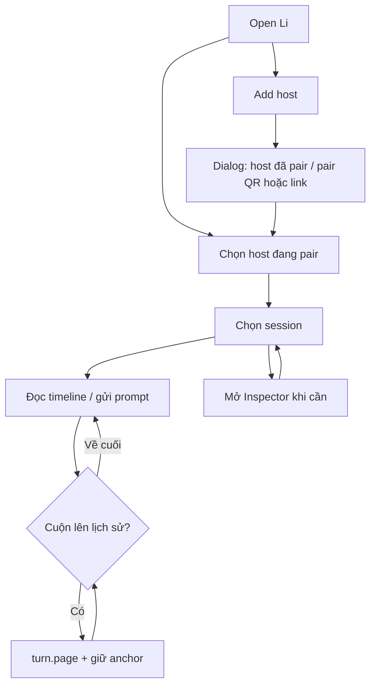

# Spec: Li Web — workbench tối giản và duyệt hội thoại dài

> SUPERSEDED cho source work mới bởi `docs/specs/.working/SPEC-2026-11-23-li-web-demo-integration.md` (owner đổi visual reference sang design demo và yêu cầu tích hợp product). Giữ file này làm lịch sử review/UAT; Task T6 “Temp-only, không sửa apps/web” không còn là scope hiện hành.

## Context Snapshot
- Project / module: Li Web PWA trong `apps/web` của LiX; surface `Operate`, không phải landing page.
- Source lane: `D:/pcloud/workspace/code/android/pi-app-r4-fix-create-open`, branch `li-web/fix-create-open`, HEAD `f3520680fa638406446b158d1261c24cbe333000`. Đây là source lane R6 đã dùng cho pair UAT production; không sửa canonical `pi-app/pi-app` main vì main đang có thay đổi F2 chưa commit.
- Stack: React + TypeScript + Vite. Web hiện dùng CSS variables/component classes ở `apps/web/src/styles.css`; Tailwind config có trong repo nhưng content scan chỉ nhắm Electron `src/renderer`, không có Tailwind utility trong `apps/web/src`.
- Current behavior: app vẫn hiện header “Li Web”; host/pair là một `
` panel chiếm chiều cao; host chip có nút × riêng; desktop rails cố định 240px/320px; inspector Context mở mặc định; Composer dùng native select model/thinking và radio cho mọi chế độ; timeline tải 20 turn cuối và chỉ có nút bấm tải trang cũ; tool success hiện `ok` và mỗi tool là một card xám; xterm dùng theme mặc định đen; Files hiện nút “Đổi tên” trên mọi hàng.
- Desired behavior: giữ LiX là nguồn host/session, nhưng PWA trở thành bề mặt yên, trắng, ít chrome; mở host/pair và panel phụ khi cần; đọc được lịch sử dài mà không bị giật khỏi vị trí; tìm model nhanh mà không mất model nào server cho là dùng được.
- Relevant files: `apps/web/DESIGN.md`, `index.html`, `src/hosts/HostManager.tsx`, `src/workbench/{Workbench,SessionRail,Timeline,timeline-store,Composer,Inspector,SettingsPanel}.tsx`, `src/styles.css`, `src/dev/workbench-preview.tsx`, các test cùng thư mục.
- Project truth / guard: giữ host namespace riêng và `HostConnection`/RPC hiện tại; pair token một lần vẫn chỉ ở memory, fragment bị xoá khỏi history, không persist token; không thay gateway, shared protocol, Android, ProDesk, T20, WSS/Serve, DNS, firewall hay deployment.

### Screenshot evidence ledger
- `C:/Users/quocn/Downloads/bc1725b5-4c3e-4de1-92e3-940ebda94c22.png`: connected shell, host/pair disclosure mở, hai host chips, session rail/timeline/inspector.
- `C:/Users/quocn/Downloads/5f86606a-ae00-4e95-b9a0-e924a871f5ec.png`: Terminal tab, canvas đen trong app sáng.
- `C:/Users/quocn/Downloads/33e905ce-2b6e-4e83-8c66-105bdbf1e56d.png`: Files tab, nút rename lặp từng hàng.
- `C:/Users/quocn/AppData/Local/Temp/pi-clipboard-d214a3ca-691d-4e07-b5a3-0d5b0e67615f.png`: timeline dài, tool status, composer và Context pane; viewport metadata không có nên không đoán kích thước.
- LiX reference: `apps/web/DESIGN.md` + local runtime capture `.agent-workbench/lix-web/lix-runtime-capture.png`. Ảnh owner có nội dung session thật chỉ dùng local để đọc layout, không upload lên Surf/third-party.

## Objective
- Làm Li Web nhìn và dùng như một workbench LiX gọn, rõ, calm; phần chính là session/timeline/composer, không phải các tấm card giải thích.
- Thành công khi mày đổi host/session, đọc tiếp một session dài, tìm model, gửi prompt và mở panel phụ mà không phải mò, không bị timeline nhảy, không bị controls/status thừa tranh mắt.

## Scope
- In:
  - Đổi tên page/document title thành `Li`; bỏ header chữ “Li Web” và tagline tĩnh.
  - Gộp host switch/add/pair vào shell gọn; pair/host management mở popup/dialog theo yêu cầu.
  - Left session rail và right Inspector có thể ẩn/mở; desktop resize có giới hạn, lưu preference UI cục bộ; mobile reflow thành drawer/sheet.
  - Long history: auto-load trang cũ khi cuộn lên, giữ anchor đang đọc, tách trạng thái follow-live, có đường về cuối phiên; dùng RPC `turn.page` hiện có.
  - Composer model search/group; giảm chrome controls; giữ mọi model available, thinking level, attach, steer/follow-up/abort.
  - Tool success không hiện chữ `ok`; tool running/error vẫn có feedback đúng nghĩa; bỏ nền/card xám lặp nếu không nhóm nội dung.
  - Inspector/Files actions gọn; Terminal light theme trắng/đen; dark theme vẫn theo theme hiện có.
  - Cập nhật `apps/web/DESIGN.md` và synthetic dev preview sau khi kết quả đã verify.
- Out:
  - Thay wire protocol/API, gateway/session security, session data format, model availability/filtering phía host, Android, Pi SDK, ProDesk, T20, Serve/DNS/firewall, production deploy.
  - Thêm full-text message search, sửa product capability matrix/parity scope hoặc đổi semantics host/session.
  - Tailwind migration, framework/primitive base mới, package dependency mới chỉ để restyle.
  - Upload owner screenshots/private session content lên dịch vụ ngoài.

## Thuật ngữ
- Host switcher: điều khiển chọn một host đang pair; không phải thao tác xoá device key.
- Forget: xoá browser device key của host; khác với đóng kết nối tạm thời, phải có confirm.
- Older page: một trang lịch sử từ RPC `turn.page`, hiện limit 20 turn.
- Follow-live: tự theo cuối timeline chỉ khi user đang ở gần cuối; user cuộn lên thì tách follow.
- Collapse/resize: preference giao diện local; không gửi lên host, không thay đổi dữ liệu session.

## UX Baseline
1. Keyboard: Tab theo thứ tự host → session rail → timeline → composer → inspector; Enter gửi theo path hiện tại; Escape đóng dialog/popover và trả focus về trigger.
2. Focus: pointer focus không tạo viền đen/ring; keyboard focus phải perceptible trong ảnh keyboard-focused — không dựa riêng vào màu; nếu dùng marker/edge thì contrast non-text ≥3:1, nếu dùng fill thì ghép với cue không màu (weight/shape).
3. A11y: controls có name/role; modal focus containment/return; combobox dùng keyboard; errors `role=alert`, live progress `role=status`; text ≥4.5:1, targets ≥44px.
4. Viewport: 320–1440px không tràn ngang; mobile dùng drawer/sheet thay vì nén ba cột; semantic reading/focus order giữ nguyên.
5. States: host offline/connecting, pair empty/loading/error/success, model no-result, timeline older-loading/end, live-follow detached/attached, tool running/failed/completed, terminal opening/open/exited đều có state thật; không dựng data giả trong production.
6. Consistency: giữ CSS variables hiện có làm một styling system; trắng `#fff` là nền chính, text `#111`, secondary/muted đủ contrast; soft fill chỉ cho hover/selected/grouping, bỏ divider/card nền trang trí.
7. Platform: browser scroll/caret/native selection đúng; terminal dùng palette theo theme (light: trắng/đen, dark: tương ứng dark); honor reduced motion.
8. Copy: xoá intro/hint/status lặp; chỉ giữ pair/security note ngắn và error/recovery/busy state mà user cần để hành động.

## Assumptions / Open Questions
- Hướng nhìn đã đủ rõ: LiX desktop calm + Owner UI Baseline white-first; không mở style-choice tournament và không tạo visual world/brand mới.
- Tailwind không tự làm giao diện tốt hơn. Vì `apps/web` hiện là CSS variables/plain CSS và config Tailwind đang nhắm Electron renderer, task giữ nguyên một styling system; không migrate framework.
- “Model rác” được xử lý bằng search + provider grouping + current/recent presentation; không xoá/hide model mà host trả về là available. Model groups/provider đã có trong `model.list`; Web hiện đang bỏ mất hai field này.
- Terminal đổi thành trắng/đen ở light theme; nếu OS/app ở dark theme, vẫn theo palette dark để không tạo mảng trắng chói. Không thêm theme switch trong task này.
- Long-session browsing nghĩa là user có thể tới mọi turn cũ bằng cuộn và trang hoá ổn định, không mất vị trí; không thêm search nội dung hội thoại ở phase này.
- Không có blocker cần hỏi owner trước khi hoàn thiện spec; owner có thể sửa scope/acceptance khi review.

## Approach
- Direction: LiX Desktop calm/white-first (UI-Q recipe khi phù hợp), giữ identity LiX và Owner UI Baseline; đây là re-skin trong visual world đang có, không tạo brand/world mới.
- Chọn re-skin trong hệ LiX hiện có: sửa semantic CSS variables + component classes, không thêm Tailwind song song. Đây là ít rủi ro hơn migration framework và đúng hiện trạng code.
- Giảm thao tác thường trực: host switch ở top bar, pair/manage trong dialog; session rail là navigation chính; Inspector là utility rail mở khi cần; Composer giữ full-width input và một hành động Send rõ.
- Duyệt lịch sử bằng `turn.page` hiện có: auto-load khi gần top, in-flight guard, giữ anchor sau prepend; không auto-scroll khi user đang xem lịch sử; `Jump to latest` xuất hiện khi follow-live detached. Không đổi schema/RPC.
- Chỉ presentation lọc model: giữ provider/group metadata qua Workbench; searchable popover nhóm theo provider, current model được đánh dấu; kết quả rỗng có recovery. Không lọc server data.
- Giữ feedback có nghĩa: bỏ success label `ok` và gray tool card; running/error vẫn hiện cue ngắn + screen-reader announcement; chi tiết lỗi/preview chỉ reveal khi mở.
- Code-led, không dùng OpenPencil/Surf: LiX identity đã có và user screenshots chứa session text; local synthetic fixture + fresh local reviewer cung cấp evidence an toàn hơn.

## Bỏ qua
- Không migrate apps/web sang Tailwind/shadcn chỉ để đổi màu/spacing; không đổi protocol/schema/host runtime.
- Không thêm message full-text search, favorites/blocklist model, hoặc desktop-only workflow chưa có trong LiX Web parity scope.
- Không làm public deployment, pair host thật bằng token trong test, hay gửi screenshot/session content cho dịch vụ ngoài.

## Flow

Current:
1. Mở PWA → header “Li Web” → disclosure Hosts & ghép nối.
2. Mở disclosure để thấy danh sách host và pair panel cùng lúc.
3. Chọn host chip → chọn session ở rail → timeline/composer; Inspector mở default ở Context.
4. Đọc turn cũ phải lên đầu timeline rồi bấm “Xem các lượt cũ hơn” từng 20 turn; không có JS scroll anchoring/jump-to-latest.
5. Model/thinking là native selects trong footer; tool success hiện `ok`; Terminal xterm tự vẽ nền đen.

### Friction có evidence
1. **Pair chrome luôn chiếm chỗ:** header và `
` panel ở `hosts/HostManager.tsx:197-207`; mở pair đẩy workbench co trong `.li-web-root.connected` (`styles.css:306-317`). Impact: mỗi lần quản lý host chiếm chiều cao dù đây là flow hiếm.
2. **Rails cứng và inspector luôn mở:** grid dùng cột cố định 240px/320px, không có collapse/resize (`styles.css:196-216`); Inspector mở mặc định `Workbench.tsx:27`. Impact: chat bị bó hẹp khi panel phải chỉ chứa Context.
3. **Model picker phẳng:** `Workbench.tsx:89-100` bỏ `provider/group` từ `model.list`; `Composer.tsx:178-188` render native selects. Server đã lọc unavailable và trả group/provider (`methods.ts:81-85`, `remote-host-electron.ts:253-268`), nên vấn đề là cách trình bày, không phải thiếu model data.
4. **Lịch sử cũ khó tới và dễ nhảy:** timeline ban đầu chỉ 20 turn (`session-hub.ts:26,944-945`); user phải bấm nút ở đầu list (`Timeline.tsx:132-138`), `turn.page` nạp 20 turn (`Workbench.tsx:385-391`), không có JS scroll anchoring/follow/jump. `prependOlder` chỉ prepend + dedupe (`timeline-store.ts:19-22`).
5. **Noise trong transcript và panel:** tool header in status thô (`Timeline.tsx:26-46`) trên card nền xám (`styles.css:255-259`); Thinking lặp từng disclosure; Files có rename button mỗi row (`Inspector.tsx:206`); Terminal không set theme xterm (`Inspector.tsx:60`).
6. **Token CSS thiếu:** web dùng `--message-user-bg`, `--diff-added/removed` và `--composer-shell-shadow` nhưng không khai báo trong `styles.css`; một số surface có thể rơi về style mặc định.

Proposed:
1. PWA mở trực tiếp workbench; top bar chỉ có host switcher gọn + Add host (không h1/tagline).
2. Add host mở dialog/sheet: host đã pair và pair mới ở cùng một chỗ; đóng dialog không đổi layout/session.
3. Left rail chọn session, main timeline đọc/gửi; Inspector collapsed mặc định, bật khi cần Review/Files/Context/Tree/Agents/Terminal.
4. Composer có prompt field rộng; model/search và thinking là controls gọn; send mode nâng cao nằm trong menu nhưng không mất.
5. Scroll lên để tự nạp lịch sử cũ và giữ nguyên vị trí đọc; cuộn lên thì tắt follow-live; nút `Về cuối` hiện tới khi user quay lại tail.

## Risks
- Resizing, modal semantics và scroll anchoring đều có state/keyboard edge cases; nếu chỉ sửa CSS mà không thêm component tests/runtime evidence thì UI có thể trông đúng nhưng hành vi hỏng.
- Long-history auto-load chạy song song với live patches; phải giữ `seq`, order, dedupe và không để `ResizeObserver`/stream kéo user khỏi lịch sử.
- Model metadata đã có `provider/group`, nhưng test hiện tại truyền `models=[]`; thêm multi-provider fixtures để bắt lỗi mất selection hoặc giấu model.
- `apps/web/DESIGN.md` phản ánh token cũ và user muốn trắng hơn; chỉ update sau khi có screenshot đã verify, không đổi DESIGN trước rồi coi đó là bằng chứng.
- Canonical `pi-app/pi-app` main có thay đổi F2 chưa commit; chỉ làm trong branch R6 `pi-app-r4-fix-create-open`, không cherry-pick/merge main trong spec này.
- Owner screenshots chứa text session thật; chỉ dùng local layout evidence, không gửi lên Surf hay dịch vụ ngoài.

## Task List

### Task 1 — Li shell, host switcher và pairing dialog
- Objective: bỏ header/pair disclosure thừa, nhưng giữ host switching/pair/forget an toàn.
- Acceptance:
  - `document.title`, web manifest `name` và `short_name` đều là `Li`; không còn H1 “Li Web”/tagline trong workbench.
  - Connected shell có một host switcher nhỏ và trigger Add host; không còn hai host chip có nút × rời cạnh nhau.
  - Pair/manage mở dialog (desktop) hoặc sheet (mobile), không đẩy/co workbench khi mở; mở/đóng qua Escape, backdrop, close button; focus trả về trigger.
  - Dialog liệt kê host/status; kết nối và đóng kết nối tạm rõ ràng; Forget có confirm riêng để không nhầm với disconnect.
  - Pair scan/paste/link vẫn dùng parser hiện tại; pair token chỉ nằm trong memory; error/success đúng role, không hiện lời giải thích tĩnh dài.
  - Empty state chỉ có một hành động kết nối host, không có hai card intro.
  - `Host & session settings` vẫn accessible nhưng là disclosure advanced collapsed ở footer; không lặp status/settings trong host switcher hay Pair dialog.
- UX Contract: states `no-host`, `dialog-closed`, `host-list`, `pair-input`, `scanning`, `connecting`, `success`, `error`; modal labels/keyboard/focus return; không đọc/lưu token ngoài handshake hiện hữu.
- Skills: `ui-design`, `flow`, `mobile-responsive`, `frontend-taste-chatgpt`.
- Visual Ref: `apps/web/DESIGN.md`; `.agent-workbench/lix-web/lix-runtime-capture.png`; screenshot evidence trong Context Snapshot.
- Reproduce: `npm exec -- vitest run apps/web/src/hosts/HostManager.integration.test.tsx apps/web/src/hosts/pair.test.ts`.
- Verify: pair/manage component tests; render dialog open/closed/empty/error in a synthetic `host-manager-preview.html` using `MemoryDeviceKeyStore` + fake socket; do not create a real pair token or connect a real host.
- Files: `apps/web/src/hosts/HostManager.tsx` (existing HostStore/pair callbacks), `apps/web/src/hosts/HostManager.integration.test.tsx`, `apps/web/src/hosts/pair.test.ts`, `apps/web/dev/host-manager-preview.html` (new synthetic visual fixture), `apps/web/src/dev/host-manager-preview.tsx` (new synthetic visual fixture), `apps/web/index.html`, `apps/web/public/manifest.webmanifest`, `apps/web/src/styles.css`.

### Task 2 — Collapsible/resizable workbench rails
- Objective: cho timeline đủ chỗ đọc; sidebar trái/phải điều chỉnh được, không chiếm bề rộng cố định.
- Acceptance:
  - Left session rail collapse/expand và resizable desktop; có keyboard separator (Arrow/Home/End) và trạng thái/width persist local-only, clamp hợp lý.
  - Inspector collapse/expand và resize tương tự; mặc định mở trang mới ưu tiên timeline (Inspector closed), user preference đã lưu được tôn trọng.
  - 320–768px dùng drawer/sheet, không ép 3 cột; 769–1024px reflow; ≥1025px dùng grid theo width còn lại; focus order giữ nguyên.
  - Session/host selection, active session và RPC behavior không đổi khi collapse/resize.
- UX Contract: handle là `role=separator` với `aria-orientation`, `aria-valuemin/max/now`; nút toggle có `aria-expanded`; resize không làm mất scroll/selected session; prefers-reduced-motion. Mobile session drawer có scrim; Escape/scrim-tap đóng; focus trả về toggle; toggle có `aria-expanded`.
- Skills: `ui-design`, `flow`, `mobile-responsive`, `frontend-taste-chatgpt`.
- Visual Ref: `apps/web/DESIGN.md` + owner screenshot của 3-pane layout.
- Reproduce: `npm exec -- vitest run apps/web/src/workbench/components.test.tsx apps/web/src/workbench/connection-states.test.ts`.
- Verify: tests collapse/expand/resize/persist/host switch; `node apps/web/scripts/capture-responsive.mjs` captures and asserts overflow at 320/375/768/1024/1280/1440 after Task 5 adds 1024.
- Files: `apps/web/src/workbench/Workbench.tsx` (grid/controls), `apps/web/src/workbench/SessionRail.tsx`, `apps/web/src/workbench/Inspector.tsx`, `apps/web/src/styles.css`, component tests.

### Task 3 — Timeline đọc lịch sử dài và tool feedback
- Objective: cho phép xem mọi trang cũ mà không làm user mất vị trí; bỏ noise thành công nhưng giữ failure/progress.
- Acceptance:
  - Khi `hasOlder=true`, scroll gần top tự gọi `turn.page` với current first anchor; chỉ một request in-flight cho một session.
  - Sau prepend, anchor đang nhìn không lệch quá 8px; dedupe/order/seq semantics giữ nguyên; cuối lịch sử ngừng fetch.
  - Khi user rời bottom, stream token không kéo họ về; `Về cuối` xuất hiện; scroll gần bottom hoặc nhấn nút mới reattach follow-live.
  - Success tool không hiện raw text `ok`; tool row không có nền/card xám trang trí; running có cue nhỏ; failed giữ message/recovery nhưng bỏ nhãn thô “error”. Thinking giữ thứ tự, mặc định collapsed, không lặp nền/border.
  - Không đổi RPC/schema, không thêm message search; history vẫn phân trang bằng `turn.page` limit hiện có.
  - Response `turn.page` về sau `timeline.reset`, reopen session, host switch hoặc anchor/generation đổi phải bị discard; không được prepend history stale vào timeline mới.
  - Khi page lỗi, hiện state `older-error` ngay tại control để retry; khi prepend older page, screen reader không announce cả page như nội dung mới.
- UX Contract: states `older-loading`, `older-error`, `has-older`, `end`, `follow-live`, `reading-history`, `tool-running`, `tool-failed`; progress/error có `aria-live`; timeline giữ `role=log` nhưng tắt `aria-live` cho bulk prepend; live status dùng region gọn riêng; older-load announce một status ngắn, không đọc lại cả page; không reload whole session để xem turn cũ.
- Skills: `ui-design`, `flow`, `mobile-responsive`, `frontend-taste-chatgpt`, `test`.
- Visual Ref: screenshot timeline của owner + current LiX timeline reference; synthetic long-session fixture mới.
- Reproduce: `npm exec -- vitest run apps/web/src/workbench/timeline-store.test.ts apps/web/src/workbench/components.test.tsx`.
- Verify: 100-turn fixture; auto-page/anchor giữ anchor ≤8px/dedupe/no duplicate request; deferred `turn.page` response sau `timeline.reset` bị bỏ; older-page error retry được; user scroll during streaming không jump; keyboard jump-to-latest; screen reader không announce page cũ như turn mới; rendered screenshot tại 1280/1440 và mobile.
- Files: `apps/web/src/workbench/Timeline.tsx`, `timeline-store.ts` (chỉ thêm logic nếu cần), `Workbench.tsx` (`turn.page` wiring), `styles.css`, `timeline-store.test.ts`, `components.test.tsx`.

### Task 4 — Composer/model picker và Inspector/Terminal
- Objective: thu gọn controls nhưng không làm mất model/host capability; sửa mismatch terminal.
- Acceptance:
  - Web giữ `provider` + `group` từ `model.list`; searchable popover lọc theo id/name/provider và group theo provider; current model được đánh dấu; mọi model server trả available đều tìm/chọn được; không tạo server filter.
  - Sau `model.set` thành công, picker đánh dấu model vừa chọn ngay; không để `timeline.turns.at(-1).meta.model` cũ ghi đè model mới trước turn tiếp theo.
  - Thinking/mode/attachment/send giữ đủ semantics; default Send rõ, mode nâng cao qua compact menu, model/thinking có nhãn accessible và keyboard nav; không dùng native `<select>` cho model list dài.
  - Bỏ token/cost lặp khỏi composer footer (Context inspector vẫn xem được); chỉ hiện cue context gọn khi đã ≥80% window; không che queued/abort/error state.
  - Inspector tabs không bị cắt ở 320–768px; export actions ra khỏi tab row; Files không render nút “Đổi tên” trên mọi hàng, nhưng rename/create/read vẫn reachable bằng menu/action; preview đóng được.
  - Terminal light theme có nền trắng/chữ đen, ANSI palette đọc được; dark theme vẫn tương ứng theme global; OSC 52 filter và terminal lifecycle không đổi.
  - Định nghĩa đủ CSS variables hiện đang bị dùng nhưng thiếu (`--message-user-bg`, `--diff-added`, `--diff-removed`, `--composer-shell-shadow`) và không hardcode màu ngoài tokens.
- UX Contract: model popup `closed/open/searching/results/no-result`; arrow/Enter/Escape/Home/End/focus return; no-result message concise; async `model.set` pending trên trigger; Terminal states opening/open/exited/error; file action menu keyboard/touch accessible.
- Skills: `ui-design`, `mobile-responsive`, `frontend-taste-chatgpt`, `test`.
- Visual Ref: `apps/web/DESIGN.md`; prior art `src/renderer/src/features/composer/model-picker.tsx` và `src/renderer/src/features/timeline/timeline-view-jump.ts` (mechanism reference, không copy desktop CSS/Tailwind).
- Reproduce: `npm exec -- vitest run apps/web/src/workbench/components.test.tsx apps/web/src/workbench/terminal-pane.test.tsx`.
- Verify: model fixtures nhiều provider + current/no-result; `model.set` optimistic selection; keyboard combobox; terminal theme mock; existing OSC52/input/resize/close tests pass; browser render light/dark.
- Files: `apps/web/src/workbench/Composer.tsx`, `Workbench.tsx` (preserve `ModelInfo` fields), `Inspector.tsx`, `styles.css`, `components.test.tsx`, `terminal-pane.test.tsx`.

### Task 5 — Synthetic preview, design doc và final visual gate
- Objective: verify UI bằng dữ liệu giả, cập nhật design source-of-truth và không đụng production/user sessions.
- Acceptance:
  - `src/dev/workbench-preview.tsx` có nhiều provider/model, 100-turn long-history sample, tool success/running/error, files/inspector states; mọi text là synthetic, không user data.
  - `src/dev/host-manager-preview.tsx` + `dev/host-manager-preview.html` render host/pair modal bằng MemoryDeviceKeyStore/fake socket; không dùng pair token/host thật.
  - `scripts/capture-responsive.mjs` mở rộng `WIDTHS` thêm 1024px để cover đủ responsive matrix.
  - `apps/web/DESIGN.md` mô tả visual system cuối (nền/text/surface/spacing/type/control, light/dark) và trỏ runtime screenshots; không còn hướng dẫn trái với Owner UI Baseline/implementation.
  - Source branch không sửa `src/main/remote/**`, `packages/shared/remote/**`, `apps/mobile/**`, lockfile hoặc production config; không push/deploy.
- UX Contract: preview state tự nhận diện là demo, không kết nối host thật; màn hình có empty/loading/error và keyboard focus state.
- Skills: `ui-design`, `mobile-responsive`, `verify`.
- Visual Ref: owner screenshots + paired local before/after `.impeccable/review/` artifacts.
- Reproduce: `npm run web:dev -- --host 127.0.0.1` → mở `/dev/workbench-preview.html`; then `npm run web:build`.
- Verify: `npm run web:typecheck`; targeted Vitest from T1–T4; `npm run web:build`; `node apps/web/scripts/capture-responsive.mjs` at 320/375/768/1024/1280/1440; screenshots same route/states; fresh local UI/flow reviewer; no secret/session content in artifacts.
- Files: `apps/web/src/dev/workbench-preview.tsx`, `apps/web/dev/workbench-preview.html`, `apps/web/src/dev/host-manager-preview.tsx`, `apps/web/dev/host-manager-preview.html`, `apps/web/scripts/capture-responsive.mjs` (add 1024 width), `apps/web/DESIGN.md`, `.impeccable/review/` screenshots.

## Checkpoints
- C0 (spec approval): scope, design direction, model availability rule, timeline-history behavior accepted; no source code touched.
- C1: host/dialog and responsive shell tests pass; session data/identity unchanged.
- C2: rails and timeline history tests pass; verify anchor/no duplicate/no jump while streaming.
- C3: composer/model/inspector/terminal tests and web:typecheck pass.
- C4: web build, overflow matrix, before/after screenshots and fresh local UI review pass; `DESIGN.md` matches built UI.
- Production Pages deploy is a separate owner-controlled task; this spec gives no deploy authority.

## External Review Brief
### Reviewer cần phán
- Journey có đưa user vào session nhanh, giữ host/session distinction, giảm chrome thật mà không giấu hành động cần dùng không?
- `turn.page` auto-load/anchor/follow-live có giữ vị trí khi user đọc lịch sử và khi stream vẫn chạy không?
- Model search có giữ được mọi model host cho là available, không trộn namespace host và không ghi secret không?
- Pair dialog/Forget/Disconnect semantics có tránh xoá nhầm device key không?
- Màu, layout, spacing, typography và controls có khớp LiX desktop + Owner UI Baseline mà không thêm Tailwind song song không?
- Verify matrix có bao phủ screenshot views, responsive widths, keyboard/touch, states, terminal light/dark và long-session không?
### Reviewer nên đọc trước
- Spec này; `apps/web/DESIGN.md`; `apps/web/src/styles.css`; `HostManager.tsx`; `Workbench.tsx`; `Timeline.tsx` + `timeline-store.ts`; `Composer.tsx`; `Inspector.tsx`; relevant component/terminal tests; `lix-runtime-capture.png`; owner screenshots nếu cần (local only).
### Reviewer không cần phán
- Gateway security, Android protocol, ProDesk deployment/T20, DNS/Serve, full Pi parity matrix outside this UI/flow scope.

## User Test
| Hành động | Kết quả kỳ vọng | Chuẩn nhìn |
|---|---|---|
| Mở `li.quoc.app` ở viewport desktop | Vào thẳng workbench, chọn host/session | Không có header “Li Web”, pair panel hoặc intro card chiếm chiều cao khi không mở |
| Mở Add host, đóng bằng Escape, mở lại | Popup/sheet gọn, đóng không đổi session/scroll | Không đẩy layout; focus quay lại trigger; không lộ token sau khi close |
| Ẩn/mở và resize session rail/Inspector | Timeline rộng/hẹp theo ý, reload giữ preference | Handle có keyboard; width không ép chat dưới min-width, mobile thành drawer/sheet |
| Cuộn lên trong phiên dài rồi quay cuối | Tự tải thêm lượt cũ và trở về phần đang đọc; nút về cuối hoạt động | Nội dung đang đọc không nhảy; đang xem lịch sử thì stream không kéo xuống |
| Tìm model theo tên/provider và đổi thinking | Chọn được model mong muốn, mọi model khả dụng vẫn tìm được | Search có group/selected state, không còn select phẳng dài |
| Mở Terminal ở light/dark, mở Files và xem tool result | Terminal tương phản đúng theme; Files actions gọn; tool success không có `ok` | Không có mảng terminal đen trong light mode, lỗi thật vẫn đọc/khôi phục được |

5 câu Y/N:
1. Li Web vào thẳng phần làm việc và giữ được host/session đang chọn không?
2. Có mở/đóng/resize session rail và Inspector mà không làm mất vị trí hội thoại không?
3. Phiên dài có đọc được lượt cũ, giữ vị trí khi tải thêm và quay nhanh về cuối không?
4. Model search có tìm được model cần dùng mà không giấu model khả dụng không?
5. Trên mobile/desktop, terminal, controls, dialog và focus có rõ, không tràn, không bị status/copy thừa che lấp không?

## Completion Gates
- [ ] Spec được owner review/approve trước khi source edit.
- [ ] T1–T4 acceptance + targeted tests PASS; không sửa protocol/shared schemas/host backend.
- [ ] `npm run web:typecheck` + `npm run web:build` PASS.
- [ ] UI screenshot cùng view/state: 320/375/768/1024/1280/1440; `capture-responsive.mjs` có 1024 và overflow assertion exit 0; keyboard-focused primary action/model option có cue dễ nhận ra, dialog và terminal checked.
- [ ] Long-session test chứng minh older-page anchor giữ ≤8px và live streaming không kéo người đang đọc lịch sử.
- [ ] Fresh local UI/flow reviewer verdict; material findings được xử lý và recapture một vòng.
- [ ] User UAT trên `li.quoc.app` sau khi có release được duyệt; chưa deploy trong scope spec/implement.
- [ ] `apps/web/DESIGN.md` và LiX profile chỉ cập nhật sau evidence verified; không promote rule global từ task này.

## UAT Revision 1 — Feedback 2026-11-23

### Task T6 — Chỉnh prototype đang UAT
- Root cause: prototype còn brand/status/copy thừa, focus marker đen trái baseline, thiếu menu session, và layout rail/Inspector dễ lệch khi mỗi panel mở/đóng độc lập.
- Files in scope: chỉ `C:\Users\quocn\AppData\Local\Temp\li-web-workbench-design-demo-20261123.html`. Giữ nguyên preview harness bên ngoài gồm nền xám, chuyển view và Sáng/Tối theo yêu cầu mới nhất của owner. Không sửa `apps/web`, `DESIGN.md`, global design rules, protocol/host/backend, hay deploy.
- Shell: bỏ wordmark `Li` và text `Đang trực tuyến` trong app header, giữ chấm trạng thái xanh có accessible label; bỏ divider dưới header. Host dialog đóng khi click backdrop/Escape và trả focus; bỏ footnote quản lý host/pair expiry và dòng placeholder “Không có QR, token hoặc host thật trong preview”; vẫn giữ lỗi/recovery thực sự.
- Footer: bỏ disclosure `Host & session settings` và toàn bộ thông tin bố cục owner đánh dấu rác. Left rail bỏ nút collapse trùng header và `Li Web · 8 phiên`; running chỉ là chấm xanh có accessible label. Bỏ black focus bar ở search/composer nhưng vẫn giữ keyboard focus rõ bằng cue khác.
- Session: mỗi hàng có menu Đổi tên/Nhân bản/Xoá; các hành động chỉ mô phỏng dữ liệu tổng hợp, Xoá phải có confirm. Main timeline/tool/agent status dùng chữ neutral và không có hover trang trí; progress/error/accessibility vẫn rõ. Bỏ shortcut `Context` trong header phiên và nút `Đóng` bên trong Inspector; header toggle là nguồn mở/đóng duy nhất.
- Layout: khi rail trái gập, main content căn giữa; Inspector mở một mình không chồng lấn. Parent QA clarifies at 769–1024px: nếu rail trái đóng và Inspector mở, cấp grid track riêng cho main/Inspector, không phủ main bằng drawer; nếu cả hai rail mở mà không đủ chiều ngang, fallback phải giữ main đọc được và có đường đóng rõ. Resize/collapse không làm mất session hay vị trí đọc; mobile drawer/sheet giữ focus order. Composer được giữ nguyên ngoài yêu cầu bỏ focus bar.
- Parent verify: host outside-click/Escape/focus return; session action menu; rail/Inspector độc lập; mobile drawer/sheet; keyboard focus. Test 320/375/768/769/1024/1280/1440; kiểm cả `scrollWidth <= clientWidth` ở app/grid/main/composer để bắt clipping nội bộ, không chỉ document overflow. Không dùng dữ liệu/host/token thật.
- Đây là revision của preview để tiếp tục UAT, chưa phải phê duyệt implement `apps/web`. Discussion về gap của global design system là nhánh riêng; không sửa `D:\AGENTS.md`, `DESIGN_PRINCIPLES.md`, UI-Q hoặc skill global trước khi owner chốt.
